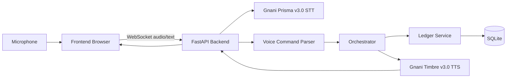

# BolKhata (बोलखाता)

A voice-powered digital ledger designed for Indian kirana store owners, supporting **Hindi**, **Hinglish**, and **English**.

---

## Tech Stack

- **Language:** Python 3.12+
- **Framework:** FastAPI
- **Database:** SQLite with SQLAlchemy ORM
- **Validation:** Pydantic v2
- **Testing:** Pytest & HTTPX TestClient

---

## Project Structure

```text
BolKhata/
├── backend/
│   ├── app/
│   │   ├── __init__.py
│   │   ├── main.py                     # FastAPI application entrypoint and route mounting
│   │   ├── database.py                 # SQLite connection, session factory and Base
│   │   ├── models.py                   # SQLAlchemy models (Customer, Transaction)
│   │   ├── routers/
│   │   │   ├── __init__.py
│   │   │   ├── customers.py            # Customer & customer-ledger endpoints
│   │   │   └── transactions.py         # Direct transaction endpoints
│   │   ├── services/
│   │   │   ├── __init__.py
│   │   │   ├── customer_service.py     # Customer management & balance calculation
│   │   │   └── ledger_service.py       # Udhaar/credit and payment transactions logic
│   │   └── schemas/
│   │       ├── __init__.py
│   │       ├── customer.py             # Pydantic models for customers
│   │       └── transaction.py          # Pydantic models for transactions
│   ├── tests/
│   │   ├── __init__.py
│   │   ├── conftest.py                 # Pytest fixtures and isolated in-memory DB
│   │   ├── test_health.py              # Health check endpoint tests
│   │   └── test_customers_ledger.py    # Customer & ledger comprehensive tests
│   └── requirements.txt                # Backend dependencies
├── .gitignore                          # Ignored files (.venv, .env, *.db)
└── README.md                           # Project documentation
```

---

## API Endpoints

### Health
- `GET /health` - System health check (`{"status": "healthy", "project": "BolKhata"}`)

### Customers
- `POST /customers` - Create a customer (Name, optional Phone, optional custom ID)
- `GET /customers` - List all customers with current balance (supports `?name=` or `?search=` substring filter)
- `GET /customers/{customer_id}` - Get customer details and current balance
- `GET /customers/{customer_id}/balance` - Get customer balance breakdown (`current_balance`, `total_credit`, `total_payment`)

### Ledger & Transactions
- `POST /customers/{customer_id}/credit` - Record credit / udhaar (increases outstanding balance)
- `POST /customers/{customer_id}/payment` - Record payment / jama (decreases outstanding balance)
- `POST /customers/{customer_id}/transactions` - Record transaction (`CREDIT` or `PAYMENT`)
- `GET /customers/{customer_id}/transactions` - View customer transaction history (newest first)
- `POST /transactions/credit` - Direct credit endpoint
- `POST /transactions/payment` - Direct payment endpoint

---

## Running the Project

### 1. Prerequisites
- Python 3.12 or higher

### 2. Activate Virtual Environment
```bash
# Windows (PowerShell)
.venv\Scripts\Activate.ps1
```

### 3. Run Tests
```bash
pytest -v
```

### 4. Start Development Server
```bash
uvicorn backend.app.main:app --reload
```
Interactive docs will be available at `http://127.0.0.1:8000/docs`.

---

## Voice and Gnani Configuration

Set these in .env (never commit it):

- GNANI_API_KEY - Gnani Vachana AI API key.
- GNANI_MOCK_MODE=true - Use mock STT/TTS for offline development.
- ALLOWED_WS_ORIGINS - Comma-separated browser origins, e.g. http://localhost:5173.
- DATABASE_URL - SQLAlchemy database URL.

## Security and Privacy

- .env is ignored by Git.
- API keys are loaded from environment variables only.
- Voice transcripts are used for command processing and spoken responses.
- The demo uses SQLite and has no authentication; use only for local/demo deployments.

---
## Architecture

## Gnani Services
- Prisma v3.0 streaming STT
- Timbre v3.0 TTS
## Privacy and Data Retention
- Raw transcripts are processed in memory and are not persisted to the database.
- Ledger records contain customer names, transaction types, amounts and dates only.
- No audio files are stored by the backend.
- No API keys are logged.
- Demo data can be removed manually from the SQLite database; no automatic deletion is implemented.
- The demo SQLite database is not encrypted at rest.
## Demo Instructions
1. Activate the virtual environment: `.\.venv\Scripts\Activate.ps1`
2. Set PYTHONPATH: `$env:PYTHONPATH="backend"`
3. Start backend: `python -m uvicorn app.main:app --app-dir backend --reload --host 127.0.0.1 --port 8010`
4. In a separate terminal, start frontend: `python -m http.server 8011 --directory frontend`
5. Open http://127.0.0.1:8011
6. Use mock mode for offline demos.
## Known Limitations
- Live Gnani API calls were not run in this environment.
- No real-device Android testing was performed.
- No noise robustness or latency SLA measurement was performed.
- No database encryption at rest.
- No transcript retention automation.
